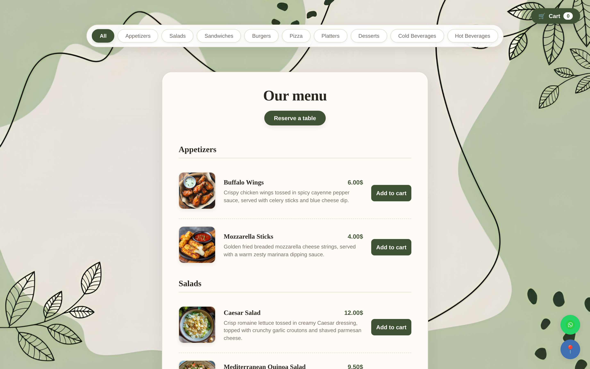
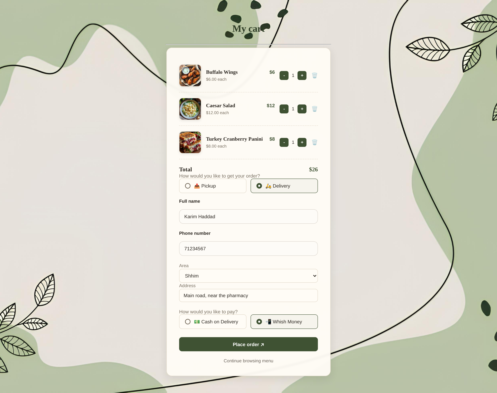
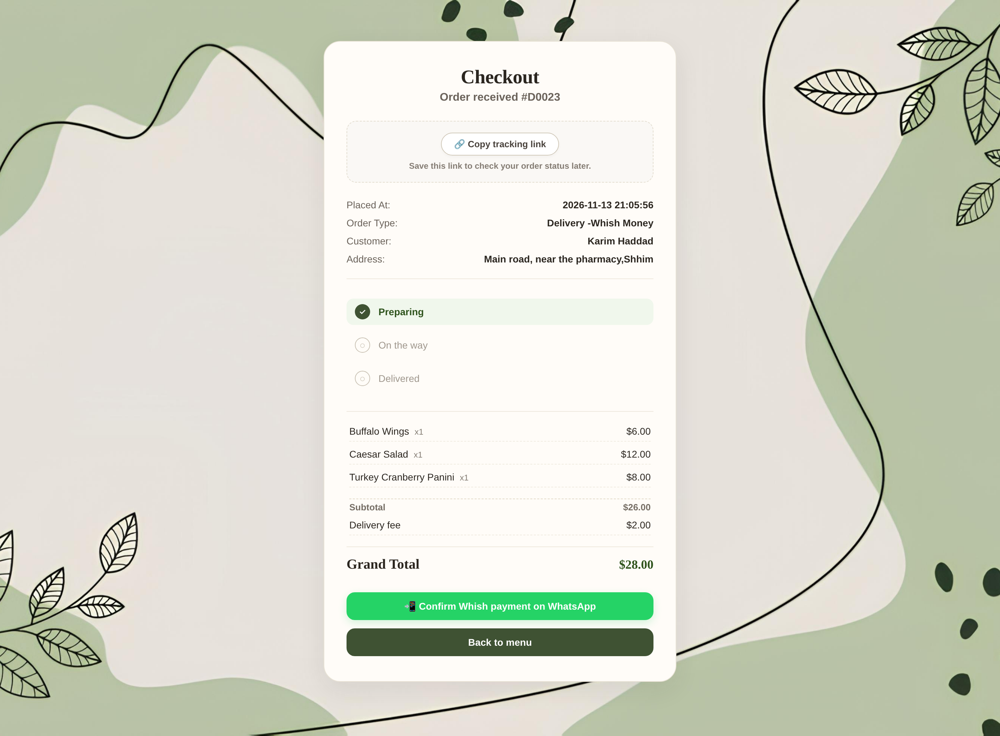
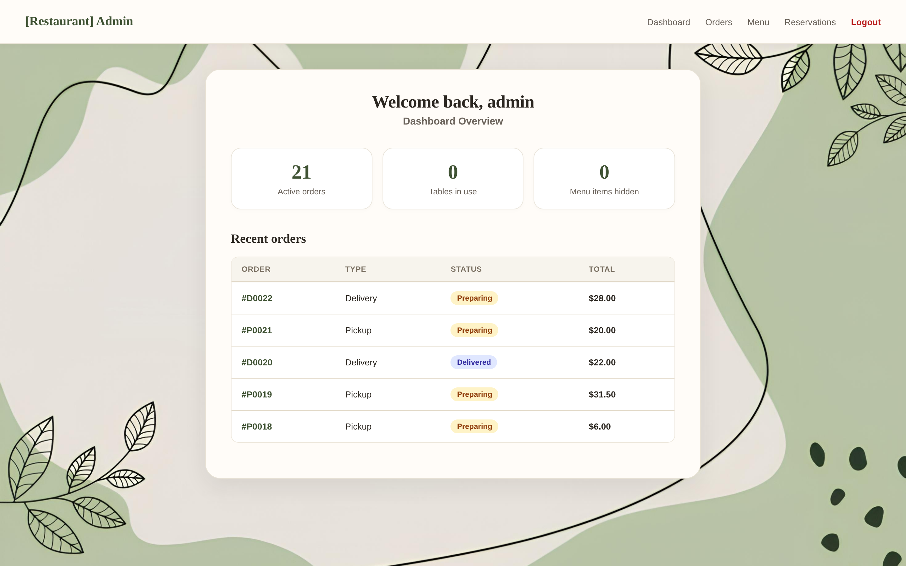
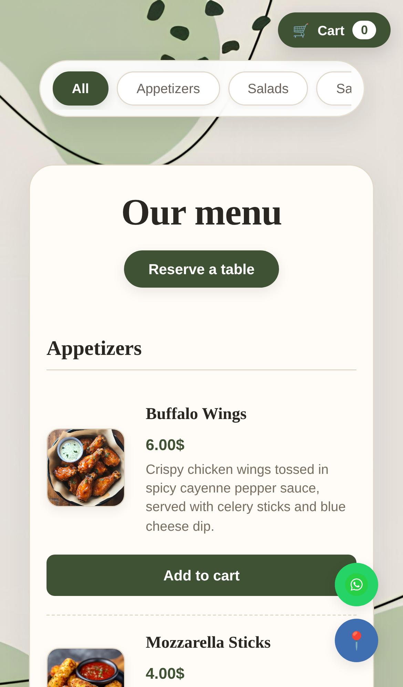

# Restaurant Ordering System

A full ordering website for small restaurants, built with **PHP** and **MySQL**. Customers order straight from the menu with no account needed, and the restaurant manages everything from an admin dashboard.

## Features

**Customer side**
- Menu as the landing page, with category filters and a mobile-friendly layout
- Cart with quantity controls, then pickup or delivery (delivery adds area, address and a delivery fee)
- Payment as Cash or Whish Money (Whish orders get a pre-filled WhatsApp message to confirm payment)
- Each order gets a private tracking link (random token) to follow its status: Preparing, On the way, Delivered
- Instant table reservation for dine-in, with an automatic hold that expires
- WhatsApp and Google Maps buttons on the menu

**Admin side**
- Separate admin login
- Dashboard with live stats and recent orders
- Orders list with filters by type and status, and pagination
- Order details with status updates
- Menu manager: add, edit, hide or delete dishes, with images
- Active reservations list
- Sound alert when a new order arrives

## Security
- Prepared statements everywhere (protection against SQL injection)
- Hashed admin password
- Order tracking uses unguessable tokens, not phone numbers or sequential IDs
- Database credentials kept out of the repository (`config.php` is gitignored)

## Screenshots

| Cart & checkout | Order tracking |
|---|---|
|  |  |

| Admin dashboard | Mobile |
|---|---|
|  |  |

## Tech stack
PHP 8, MySQL / MariaDB, HTML, CSS, JavaScript

## Run it locally (XAMPP)
1. Copy the project folder into `htdocs`.
2. In phpMyAdmin, create a database named `restaurant_v2` and import `restaurant_v2.sql`.
3. Copy `config.example.php` to `config.php` and fill in your database user and password.
4. Open `http://localhost/<folder>/client side/menu.php`.
5. Admin panel: `http://localhost/<folder>/admin side/adminlogin.php` (demo login: `admin` / `Admin@2026`).

## Author
Samir Alaaeddine, Business Computer student at the Lebanese University
